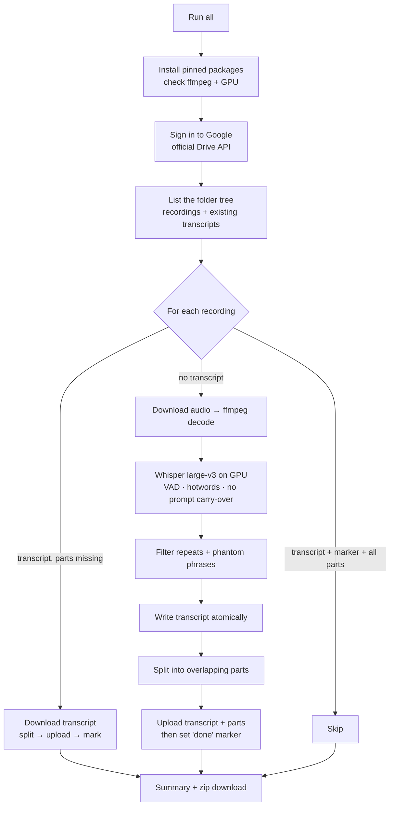

# How it works

The whole thing is one Python file, `transcribe.py`. This page explains the pipeline and — more interestingly —
**why** each part is built the way it is. Most decisions here exist because the obvious approach failed in practice.

## The pipeline



## Design decisions

### 1. Drive API instead of `drive.mount()`

The usual Colab approach mounts Drive as a folder. It works, but files written there are synced to Drive **in the
background** — if the session ends right after the last file is written, that file can be lost.

The notebook talks to Drive through Google's official API instead. Every upload has finished when the call returns,
so each recording is safely in Drive the moment it's done. Reading uses the same sign-in, so the folder never has to
be shared publicly (which is also what makes tools like `gdown` hit *"too many accesses"* errors).

### 2. Audio is decoded with the `ffmpeg` command, not PyAV

faster-whisper decodes audio with PyAV. Some PyAV releases changed the API faster-whisper calls
(`metadata_errors`), which breaks decoding with a confusing error. The notebook pipes the file through the
`ffmpeg` command line into a 16 kHz mono float array and hands that array to the model. The ffmpeg CLI has been
stable for a decade; this removes a whole class of version breakage.

### 3. Whisper settings that prevent the two classic failures

| Problem | Setting | Effect |
|---|---|---|
| Whisper "hears" words in silence and music ("Thanks for watching!") | `vad_filter=True` | A voice-activity detector cuts out non-speech before Whisper sees it. Fewer hallucinations, and faster. |
| The same sentence repeated dozens of times ("This is the code. This is the code. …") | `condition_on_previous_text=False` | Each 30-second window is decoded without the previous window's text as a prompt, so one mistake can't feed itself. |
| Leftover phantom lines | `HALLUCINATION_PHRASES` + consecutive-duplicate filter | Segments that are *only* a known phantom phrase, or identical to the previous segment, are dropped. |

### 4. `hotwords`, not `initial_prompt`

The obvious way to teach Whisper your vocabulary is `initial_prompt`. But in faster-whisper the initial prompt is part of
the "previous text" — and with `condition_on_previous_text=False` (needed for point 3) that context is **reset after the
first 30-second window**. The term list silently only helps the first half-minute of a 90-minute lecture.

`hotwords` is injected into **every** window independently, so it keeps working with the anti-loop setting.
The list is capped at about half of Whisper's 448-token context (~220 tokens) and cut from the end, which is why the
docs say "most important terms first".

### 5. Writes are atomic, uploads are verified

- The transcript is written to `name.txt.tmp` and renamed to `name.txt` only when complete. A crash never leaves a
  half-written transcript that a later run would mistake for a finished one.
- After the transcript **and all parts** are uploaded, the notebook sets an invisible Drive *file property*
  (`transcriber_part_count = N`) on the transcript. No extra file clutters your folder.
- On the next run a recording counts as done only if the marker exists **and** at least N part files are present.
  If an upload died halfway (network hiccup, Colab disconnect), the marker is missing, so the recording is re-split
  and re-uploaded from the existing transcript — seconds of work, no GPU, no re-transcription.

This also makes the notebook **adopt transcripts from elsewhere**: drop a `.txt` with the same name as a recording into
the output folder, and it will be split, filed and marked instead of transcribed again.

### 6. Chunks built for LLMs

A 90-minute lecture is 10 000+ words. Pasting that into a chat either fails or produces shallow notes. The splitter:

1. Splits into sentences, aware of abbreviations (`Dr.`, `e.g.`), initials and ordinal numbers (`2. Week`).
   Unpunctuated runs fall back to 40-word blocks.
2. Fills parts up to `CHUNK_WORDS`, always ending on a sentence boundary (soft limit).
3. Merges a tiny last part into the previous one.
4. Prepends ~`CHUNK_OVERLAP_WORDS` of **whole sentences** from the previous part, under an explicit heading
   *"Context from the previous part — already covered, do not repeat"*.

The overlap gives the model the thread; the heading stops it from summarizing the same sentences twice.

### 7. The CUDA 13 fix

In autumn 2026 Colab moved to Python 3.13 and CUDA 13 (`torch …+cu130`). Overnight, faster-whisper notebooks
everywhere started failing with:

```
RuntimeError: Library libcublas.so.12 is not found or cannot be loaded
```

**Why.** faster-whisper runs on CTranslate2, and every CTranslate2 release is compiled against CUDA 12. It does not
link cuBLAS (NVIDIA's matrix-math library) at build time; it looks for `libcublas.so.12` **by name** the first time it
needs it — which is the first real computation, *after* the model has loaded. That's why the error shows up mid-run,
on every file. CUDA 13 only ships `libcublas.so.13`, so the lookup fails. Pinning an older faster-whisper doesn't help:
all CTranslate2 versions ask for `.so.12`.

**Fix, in three moves** (`ensure_cublas12()`):

1. **Get the library.** NVIDIA publishes cuBLAS 12 as a pip package, `nvidia-cublas-cu12`. It installs the `.so`
   files into `site-packages/nvidia/cublas/lib/`.
2. **Load it before CTranslate2 asks.** Linux's dynamic loader doesn't search `site-packages`, and setting
   `LD_LIBRARY_PATH` now is useless — the loader reads it only once, when the process starts. But the loader has a
   useful rule: if a library with the requested name (*soname*) is **already loaded**, a later request for that name
   gets the loaded copy. So the notebook loads both files by **full path** with `ctypes.CDLL`. When CTranslate2 later
   asks for `libcublas.so.12`, it's already there.
   `libcublasLt.so.12` is loaded first because `libcublas` depends on it.
3. **Keep it isolated.** The libraries are loaded with `RTLD_LOCAL`, so their symbols don't leak into the global
   namespace and can't collide with the CUDA 13 libraries PyTorch has loaded.

This works because the NVIDIA **driver** is backward compatible: a CUDA 13 driver runs CUDA 12 libraries fine.
Only the user-space math library was missing.

Finally, right after loading the model the notebook transcribes **one second of silence** as a smoke test. If the GPU
setup is broken in some new way, you get one clear error up front instead of downloading every recording just to
watch each one fail.

On a runtime that still has CUDA 12, `ensure_cublas12()` finds `libcublas.so.12` immediately and does nothing.

### 8. Pinned versions

`pip install -U` ("always latest") is how notebooks break overnight. All three GPU-relevant packages are pinned
(`faster-whisper`, `ctranslate2`, `nvidia-cublas-cu12`) and only change deliberately.

## Code map

| Section in `transcribe.py` | Responsibility |
|---|---|
| `SETTINGS` | Everything a user edits |
| `normalize_key`, `is_hallucination` | Accent/case-insensitive matching for hotwords and phantom phrases |
| `split_sentences`, `plan_chunks`, `split_file` | The chunker (stdlib only, also used by the `split` CLI) |
| `install_dependencies`, `require_gpu`, `ensure_cublas12`, `load_audio` | Environment setup and audio decoding |
| `Drive` | List / download / upload / move / mark, via Drive API v3 |
| `save_to_drive` | Ordered upload: transcript → parts → marker |
| `main` | Planning (skip / split / transcribe) and the run loop |
| `split_cli` | `python transcribe.py split ...` |
